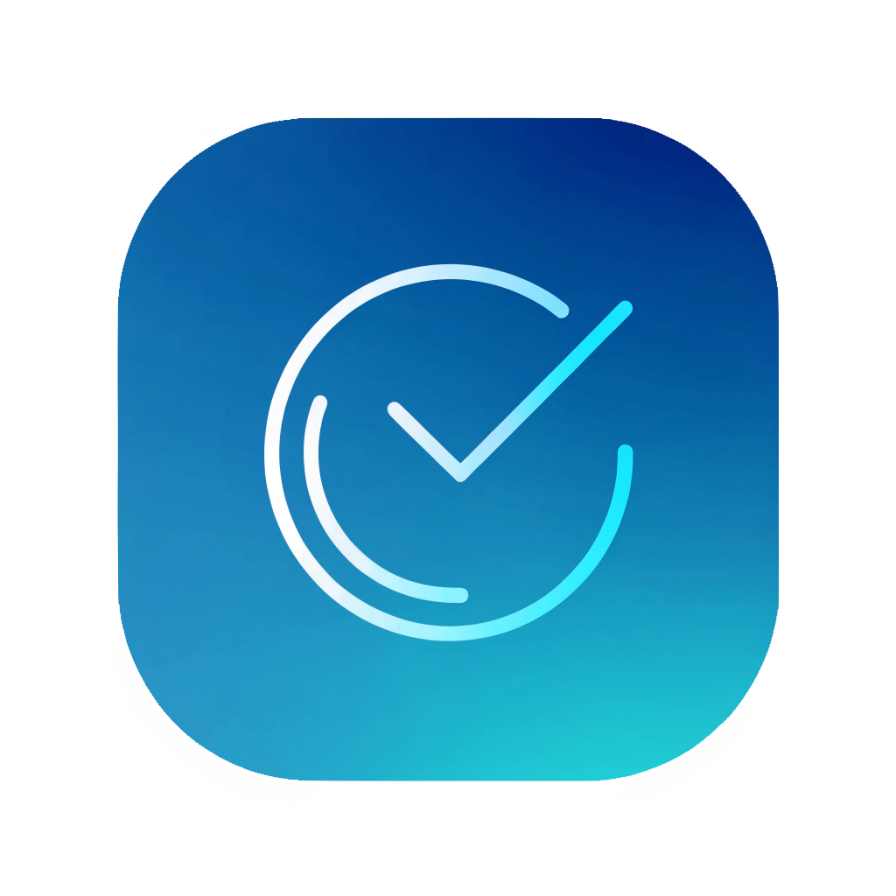

<p align="center">
  
</p>

<h1 align="center">TimeTrack</h1>

<p align="center">
  <strong>A calm desktop timesheet for people who bill hours — and need proof of the work.</strong>
</p>

<p align="center">
  Start a track. Stay in flow. Stop when you are done.<br>
  TimeTrack records the hours <em>and</em> the outcome, then exports a client-ready Excel TrackSheet.
</p>

<p align="center">
  
  
  
  
</p>

---

## Why TimeTrack exists

Freelancers, consultants, and anyone who owns a timesheet already know the gap:

- Spreadsheets are accurate only if you remember to fill them in.
- Cloud timers are noisy, subscription-heavy, and store client work off your machine.
- A duration without an **output** is hard to defend when a client or manager asks *what happened in those two hours*.

TimeTrack is a small Windows desktop app that sits beside your work. One play button. Projects you already think in. A local database. An Excel sheet you can attach to an invoice or a weekly status update.

It is built for **daily use**, not for a demo.

---

## Who it is for

| You are… | TimeTrack helps you… |
| --- | --- |
| **Freelance designer, developer, writer, or consultant** | Track billable work per client/project and export a TrackSheet with your name on it |
| **Agency or studio contributor** | Keep a personal timesheet without joining yet another SaaS |
| **Project owner or stakeholder** | Review hours *with* titles and written outputs, not a raw clock |
| **Anyone who invoices or reports time** | Turn a day’s focus into a clean, shareable record |

No account. No cloud. Copy `TimeTrack.exe` onto a USB drive if you want — the database lives next to the app.

---

## What you can do today

**Stay in flow**
- One large play / pause control, plus a stop button when a track is live
- Press **Space** to start or pause (typing a title still works as normal)
- The timer keeps counting while the window is minimized
- HiDPI-aware UI so controls stay sharp on modern displays

**Work by project**
- Create, rename, select, and delete projects
- See recent projects with total time and track count
- Open a project’s full track history: title, date, start/end, duration, and output

**Capture work, not just time**
- Name the track while it is running (“What are you working on?”)
- On stop, log **what you shipped** — results, decisions, next steps
- Your display name is stored once and printed on every export

**Hand over a real timesheet**
- Export a formatted Excel **TrackSheet** per project
- Header: user, project title, total duration, number of tracks
- Rows: day, start time, end time, duration, title, output

**Keep data yours**
- SQLite database in a local `data/` folder
- Exports you choose, saved as `.xlsx`
- Portable Windows build: one `.exe`, no installer

---

## A typical day

1. Open TimeTrack and pick (or create) the project you are about to work on.
2. Hit play. Optionally type a short title so the track has a name.
3. Pause for lunch. Resume. The clock only counts focused time.
4. Hit stop. Write the output while it is still fresh.
5. When you invoice or report, export the project TrackSheet and send the workbook.

That is the whole loop — designed to be lighter than the work it records.

---

## TrackSheet export

Each export is an Excel workbook named after the project, for example `Website_TrackSheet_20261030_1400.xlsx`.

| Field | Purpose |
| --- | --- |
| User | The name you set in the app — ready for a client-facing sheet |
| Project Title | Client or internal project |
| Total Duration | Sum of every track, `HH:MM:SS` |
| Number of tracks | How many sessions went into the total |
| Day Date / Start / End | When the work actually happened |
| Title | What the session was for |
| Output | What was delivered, decided, or left as a next step |

Use it as an invoice attachment, a weekly digest, or an archive you can open years later without an account.

---

## Run it

### Portable app (Windows)

```bat
build.bat
```

That installs dependencies and builds `dist\TimeTrack.exe`. Copy the exe (or the whole `dist` folder) wherever you like. On first launch, TimeTrack creates a `data/` folder next to the executable.

### From source

Requires **Python 3.10+**. Tkinter ships with the standard Windows Python installer.

```bash
python -m pip install -r requirements.txt
python main.py
```

Runtime dependency is **openpyxl** (Excel export). PyInstaller is only needed to produce the portable exe.

### Tests

```bash
python -m unittest tests.test_core
```

---

## How it is put together

```
TimeTrack/
├── main.py                 # entry point
├── timetrack/
│   ├── app.py              # desktop UI
│   ├── timer_service.py    # background wall-clock timer
│   ├── database.py         # SQLite projects, tracks, settings
│   ├── export.py           # Excel TrackSheet
│   └── …
├── assets/                 # app icon
├── tests/                  # core database, timer, and export tests
├── build.bat               # one-click Windows build
└── requirements.txt
```

Stack: Python, Tkinter, SQLite, openpyxl. No web server, no telemetry, no third-party API.

---

## Contribute

TimeTrack is early, useful, and intentionally small. If you track time for a living — or you like desktop tools that respect local data — you are the right person to help.

**Ways to jump in**

- Use it for a real week of work and [open an issue](https://github.com/ahmed-wael2002/TimeTrack/issues) with what broke or felt friction
- Improve the UI, accessibility, or keyboard flow
- Add tests around timer edge cases, exports, and data migrations
- Help with packaging (installer, code signing, Linux / macOS)
- Document a workflow: invoicing, agencies, student internships, internal reporting

**Good first directions** (ideas, not a roadmap promise)

- Dark mode and theme polish
- Edit or split an existing track
- CSV / PDF export alongside Excel
- Multi-day reports and date filters
- Reminders to stop a forgotten timer
- Cross-platform packaging

**Pull requests**

1. Fork the repo and create a branch from `main`.
2. Keep changes focused — one problem per PR.
3. Run `python -m unittest tests.test_core` before you push.
4. Describe the *why* in the PR: who this helps, and how you checked it.

Questions and design discussion are welcome in issues. If you are unsure where to start, open a thread and say how you currently keep a timesheet.

---

## Privacy

TimeTrack does not create an account, does not sync, and does not send your tracks anywhere. Your name, projects, hours, and outputs stay in `data/timetrack.db` on the machine that runs the app. Treat that folder like any other client work: back it up, and do not commit it.

---

## License

This project is shared so people can use it, inspect it, and improve it. If you adopt TimeTrack in a studio or client workflow, a star, an issue, or a pull request is the most useful thank-you.

---

<p align="center">
  <em>Track the hours. Keep the story of the work.</em>
</p>
